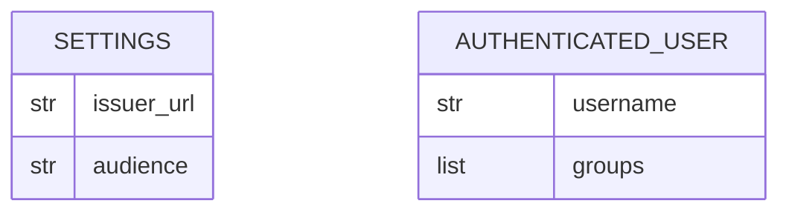

<!-- CONTRACT: Core entities — fields, types, invariants, relationships —
     shaped to translate directly into Pydantic V2 models or Go structs.
     Storage technology lives in stack.md; module boundaries in
     architecture.md (each entity is assigned to one of its modules). -->

# Test SaaS — Data models

The backend API is stateless (stack.md, Storage). Both entities are
in-memory values: `Settings` is built once at startup, and
`AuthenticatedUser` is built once per `GET /api/groups` request.

## Entities

### AuthenticatedUser
The user named by a verified token. It is also the response body of
`GET /api/groups`.

- **Module:** `identity`
- **Fields:**

| Field | Type | Required | Notes |
|-------|------|----------|-------|
| `username` | `str` | yes | From the token's `preferred_username` claim. |
| `groups` | `list[str]` | yes | From the token's `groups` claim, verbatim and in claim order. `[]` when the claim is absent. |

- **Invariants:**
  - Built only from claims that `token_verification` has already verified.
  - `username` is non-empty. `identity` rejects claims without
    `preferred_username`; `api` maps that rejection to 401.
  - `groups` holds exactly the claim's values. No stripping, sorting, or
    de-duplication: a Keycloak full-path value such as `/admins` stays
    `/admins` (vision.md, criterion 3).
  - A missing `groups` claim yields `[]`, not a rejection, so a missing
    Keycloak groups mapper shows as an empty list in the client.

### Settings
The API's runtime configuration, read from environment variables at
startup.

- **Module:** `settings`
- **Fields:**

| Field | Type | Required | Notes |
|-------|------|----------|-------|
| `issuer_url` | `str` | yes | Env `OIDC_ISSUER_URL`, e.g. `https://kc.example.com/realms/test`. Kept as the raw string: compared to the token's `iss` claim exactly and used unmodified to build the JWKS URL. |
| `audience` | `str` | yes | Env `OIDC_AUDIENCE`. Must appear in the token's `aud` claim. |

- **Invariants:**
  - Startup fails, naming the missing variable, when either variable is
    unset or empty.
  - The JWKS URL is derived as `{issuer_url}/protocol/openid-connect/certs`
    (Keycloak's fixed path). There is no separate setting and no discovery
    call at startup.
  - The client ID is not an API setting. Only the browser client's
    `config.js` uses it.

## Relationships

None. `Settings` configures `token_verification`, which gates the creation
of every `AuthenticatedUser`, but neither entity holds a reference to the
other.

